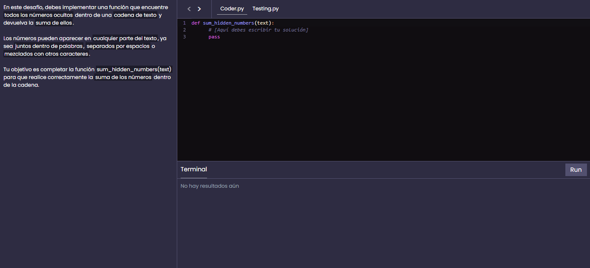

<div align="center">


# Code Knockout

**Prototipo de arena de programación competitiva: duelos, práctica y un editor de código en el navegador.**

[](https://codeknockout.onrender.com)


</div>



## Qué es

Code Knockout es una interfaz para competir resolviendo retos de programación. La idea: entrar, elegir un duelo o una práctica, escribir la solución en Monaco y ejecutarla sin salir del navegador.

Este repo es el prototipo frontend: las vistas y la ejecución de Python están implementadas; la capa de cuentas, matchmaking y persistencia todavía vive en el mundo de las ideas.

## Features

- **Editor Monaco** con resaltado de sintaxis para escribir la solución.
- **Python en el navegador** con Pyodide: sin backend para ejecutar el código.
- **Duelos** aleatorios, clasificatorios con ELO y eventos.
- **Práctica** con filtros por dificultad y lenguaje.
- **Auth UI**: login, registro y settings.
- **Responsive** con React 19, Tailwind 4 y Vite.

## Stack

React 19 · Vite · Tailwind CSS 4 · Monaco Editor · Pyodide · React Router

## Correr localmente

```bash
pnpm install
pnpm dev
```

Abre `http://localhost:5173`.

## Demo

[codeknockout.onrender.com](https://codeknockout.onrender.com)

## Estado

Prototipo en desarrollo. Si algo se ve raro, probablemente sea el lorem ipsum.
